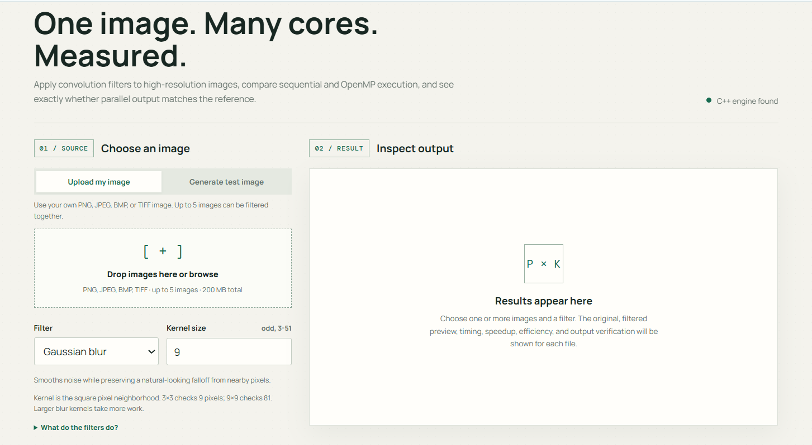
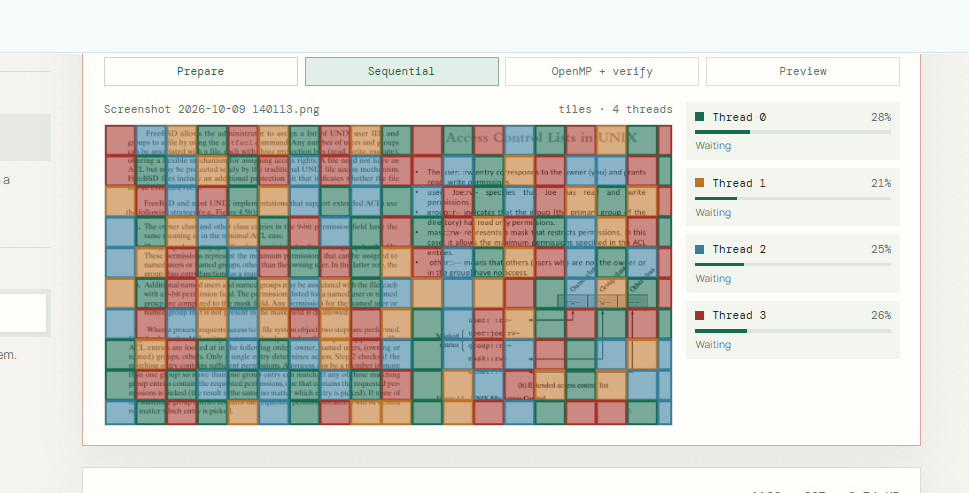
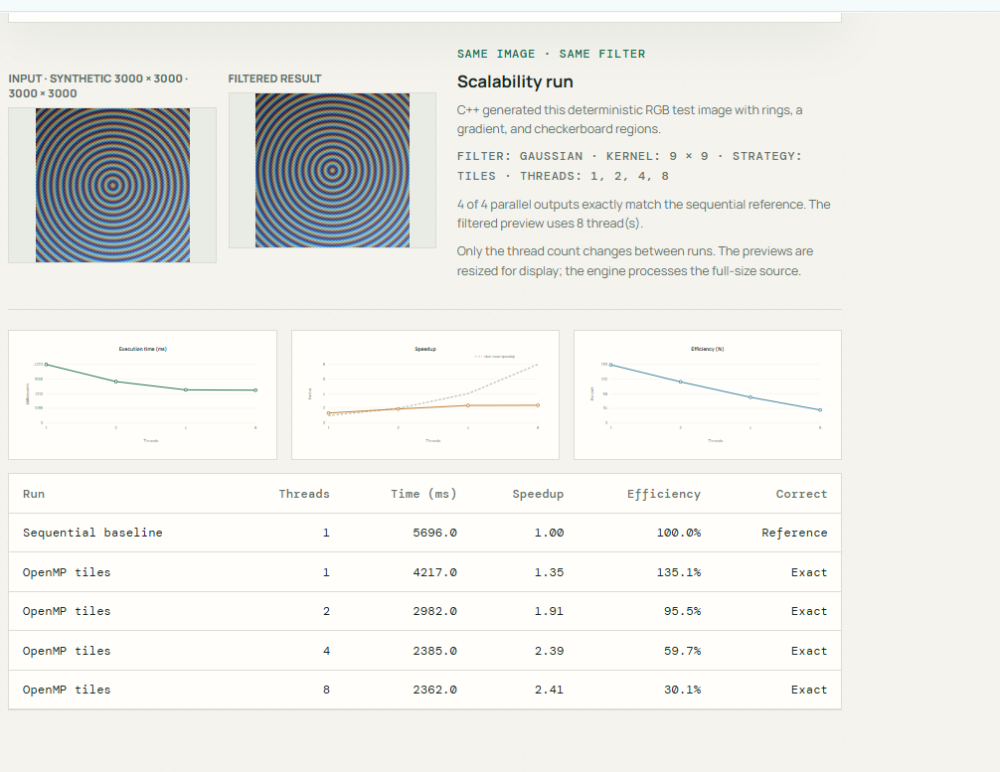
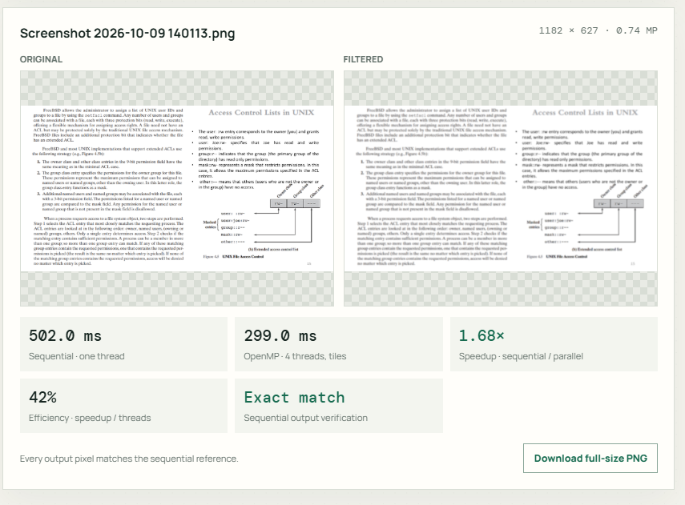
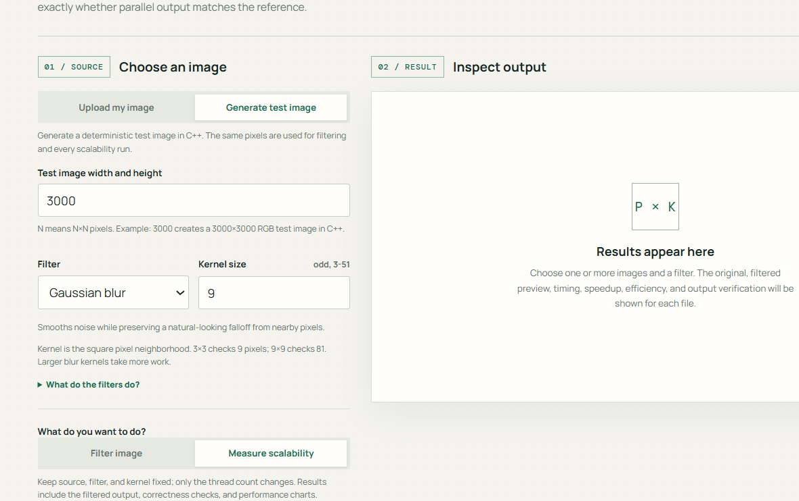
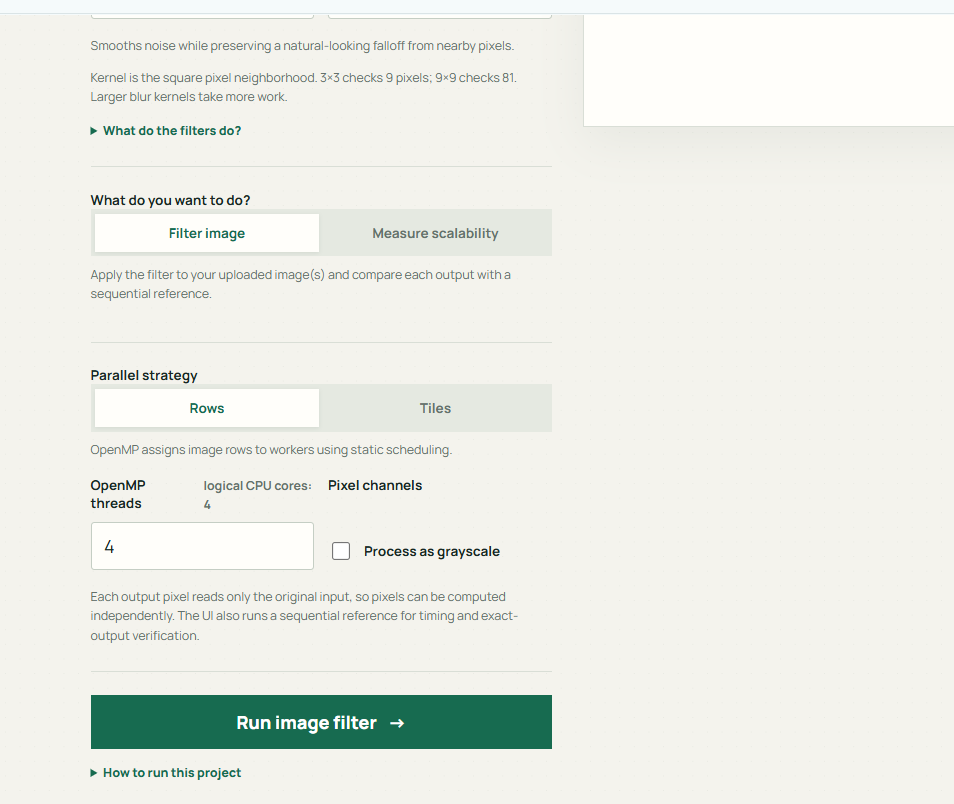
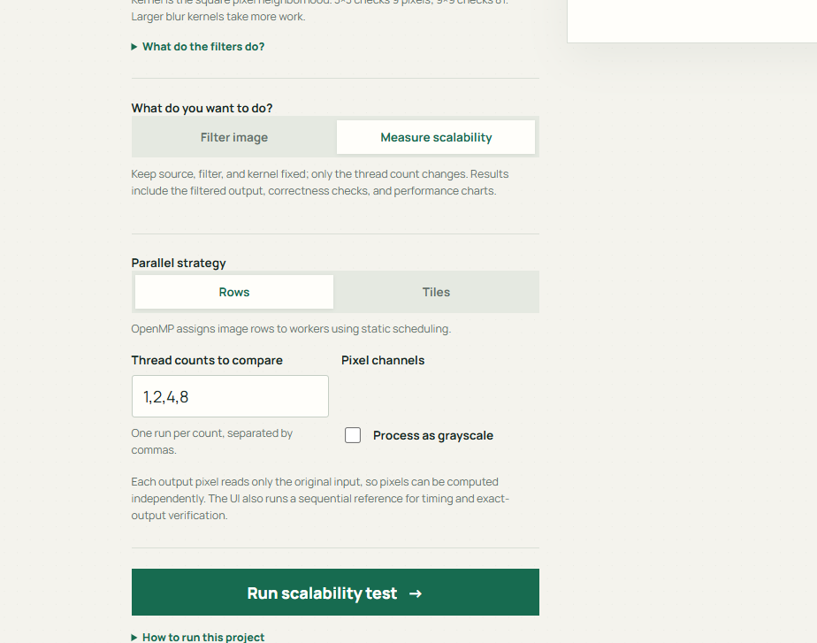

<div align="center">

# Parallel Image Convolution using OpenMP

**Sequential vs parallel image filtering with C++17, OpenMP and a Flask web interface**


[Demo Video](https://drive.google.com/drive/home?dmr=1&ec=wgc-drive-%5Bmodule%5D-goto) · [Features](#features) · [Results](#results) · [Getting Started](#getting-started)

</div>

---

## Table of Contents

- [Overview](#overview)
- [Demo](#demo)
- [Features](#features)
- [How It Works](#how-it-works)
- [Parallelization Strategies](#parallelization-strategies)
- [Performance Metrics](#performance-metrics)
- [Results](#results)
- [Tech Stack](#tech-stack)
- [Getting Started](#getting-started)
- [Troubleshooting](#troubleshooting)
- [Challenges](#challenges)
- [Future Work](#future-work)
- [Team](#team)

---

## Overview

Applying convolution filters to large, high-resolution images is slow when done sequentially, especially with large kernels. However, **every output pixel is computed only from the original input**, so pixels are independent and can be processed in parallel.

This project implements image convolution in **C++17** with **OpenMP**, compares it against a sequential reference, and wraps everything in a **Flask web interface** where you can upload an image, choose a filter, run it, and inspect timing, speedup, efficiency and correctness.

**Goals**

- Implement sequential and OpenMP-parallel convolution
- Compare **Row** and **Tile** scheduling strategies
- Measure speedup and efficiency across thread counts
- Verify that parallel output matches the sequential output exactly
- Provide a simple, user-friendly web interface

## Demo

> 🎥 **Demo video:** [Watch on Google Drive](YOUR_DRIVE_LINK)



## Features

- Upload your own images (PNG, JPEG, BMP, TIFF; up to 5 images, 200 MB total)
- Generate a deterministic synthetic test image (for example 3000 × 3000)
- Six filters: **Blur, Gaussian, Sharpen, Edge, Sobel, Emboss**
- Odd kernel sizes from **3 to 51**
- Optional **grayscale** processing
- **Row** and **Tile** parallel strategies
- Selectable OpenMP thread count
- **Measure scalability** mode (for example 1, 2, 4, 8 threads) with time, speedup and efficiency charts
- Automatic **pixel-by-pixel correctness verification** against the sequential result

## How It Works

```
Upload image → Flask converts to PPM → C++ engine → OpenMP execution → Output + timing + verification
                                                     (Sequential / Rows / Tiles)
```

1. The user uploads an image (or generates a test image) in the web UI.
2. Flask converts the image to **PPM** format.
3. The **C++ engine** applies the selected convolution filter.
4. The execution mode runs: sequential reference, row-wise parallel, or tile-based parallel.
5. The UI shows the filtered image, timings, speedup, efficiency and the verification result.

### Convolution

Each output pixel is the weighted sum of its neighbours, using the kernel weights:

```
P_new = Σ (Pixel × Kernel)
```

A 3×3 kernel reads 9 pixels per output pixel; a 9×9 kernel reads 81, so larger kernels do much more work.

## Parallelization Strategies

| Strategy | How work is divided | Scheduling | Notes |
|---|---|---|---|
| **Rows** | Image rows are split across threads | Static | Simple and effective |
| **Tiles** | Image is split into 64×64 blocks | Dynamic | Better load balancing for uneven work |

```cpp
#pragma omp parallel for
for (int y = 0; y < height; y++) {
    // process pixels in row y
}
```

Tile mode visualization: each colour is a different thread processing its own tiles.



## Performance Metrics

```
Speedup    = Sequential Time / Parallel Time
Efficiency = (Speedup / Thread Count) × 100
```

Every parallel result is compared with the sequential output and reported as an **exact match** or a mismatch.

## Results

### Scalability test

**Setup:** synthetic 3000 × 3000 image, Gaussian blur, 9 × 9 kernel, Tiles strategy, machine with 4 logical CPU cores.

| Run | Threads | Time (ms) | Speedup | Efficiency | Correct |
|---|---:|---:|---:|---:|---|
| Sequential baseline | 1 | 5696.0 | 1.00 | 100.0% | Reference |
| OpenMP tiles | 1 | 4217.0 | 1.35 | 135.1% | Exact |
| OpenMP tiles | 2 | 2982.0 | 1.91 | 95.5% | Exact |
| OpenMP tiles | 4 | 2385.0 | 2.39 | 59.7% | Exact |
| OpenMP tiles | 8 | 2362.0 | 2.41 | 30.1% | Exact |



**Observations**

- Time drops from **5696 ms to 2362 ms** (best speedup **2.41×**), and all runs are an exact match.
- Gains flatten after 4 threads because the test machine has only **4 logical cores**; extra threads add overhead.
- Speedup is not linear because of memory bandwidth limits and scheduling overhead.
- The 1-thread tiled run is faster than the sequential baseline (135% efficiency), likely because of better cache locality from tile-based memory access.

### Real image test

**Setup:** 1182 × 627 screenshot, Gaussian blur, 9 × 9 kernel, 4 threads, Tiles.

| Sequential | OpenMP | Speedup | Efficiency | Output |
|---:|---:|---:|---:|---|
| 502.0 ms | 299.0 ms | 1.68× | 42% | Exact match |

Smaller images spend a larger share of time on overhead, so the speedup is lower than in the 3000 × 3000 case.



## Tech Stack

| Area | Technology |
|---|---|
| Engine | C++17, OpenMP |
| Compiler | GCC (MSYS2 UCRT64) |
| Backend | Python, Flask |
| Image handling | Pillow |
| Frontend | HTML / CSS |

## Getting Started

### Prerequisites

- **GCC with OpenMP support** (on Windows: [MSYS2](https://www.msys2.org/) UCRT64 toolchain)
- **Python 3.x**
- Python packages: `flask`, `pillow`

### Installation

```bash
# 1. Clone the repository
git clone https://github.com/<your-username>/<your-repo>.git
cd <your-repo>

# 2. Install Python dependencies
pip install flask pillow
```

### Build the C++ engine

```bash
# Replace the file names with the ones used in this repository
g++ -std=c++17 -O2 -fopenmp <engine_source>.cpp -o <engine_output>
```

### Run the web app

```bash
python app.py
```

Then open the address shown in the terminal (usually `http://127.0.0.1:5000`). The page shows **"C++ engine found"** when the engine is built correctly.

### Using the interface

1. Choose **Upload my image** or **Generate test image** (for example 3000).
2. Select a **filter** and **kernel size** (odd, 3 to 51).
3. Choose **Filter image** or **Measure scalability**.
4. Choose the parallel strategy (**Rows** or **Tiles**) and thread count(s).
5. Click **Run image filter** or **Run scalability test** and inspect the results.

| Generate test image | Filter image | Measure scalability |
|:---:|:---:|:---:|
|  |  |  |

## Troubleshooting

- **OpenMP DLL not found (Windows):** make sure the MSYS2 UCRT64 `bin` folder (which contains the OpenMP runtime DLL, typically `libgomp-1.dll`) is on your `PATH`, or run the app from the UCRT64 terminal.
- **"C++ engine" not found in the UI:** rebuild the engine and check that the output file name matches what `app.py` expects.
- **Speedup is lower than expected:** thread counts above your number of logical cores will not help; also, small images and small kernels have too little work to hide the parallel overhead.

## Challenges

- OpenMP DLL loading issues on Windows
- Compiler compatibility on Windows
- Long processing time on large images
- Inconsistent speedup across runs
- Verifying parallel output against sequential output

## Future Work

- GPU / CUDA implementation
- SIMD optimization
- Distributed processing
- More image filters
- Real-time video processing
- Better performance visualization


<sub>Course project: Parallel Image Convolution using OpenMP.</sub>
